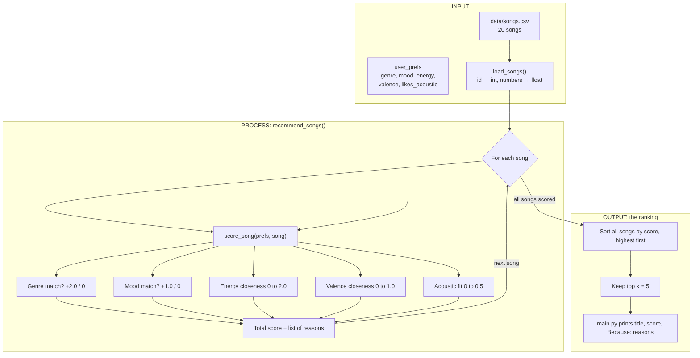

# 🎵 Music Recommender Simulation

## Project Summary

In this project you will build and explain a small music recommender system.

Your goal is to:

- Represent songs and a user "taste profile" as data
- Design a scoring rule that turns that data into recommendations
- Evaluate what your system gets right and wrong
- Reflect on how this mirrors real world AI recommenders

Replace this paragraph with your own summary of what your version does.

---

## How The System Works

Real-world platforms like Spotify and YouTube combine two approaches. **Collaborative filtering** learns from millions of users' behavior: plays, skips, likes and playlist adds ("people who liked this also liked that"). **Content-based filtering** compares the songs themselves: genre, mood, energy and other audio features. Collaborative filtering does most of the work at scale, while content-based filtering covers new songs and new users with no history. My simulation has no listening history, so it is purely **content-based**. It scores how closely each song's attributes match a user's taste profile, prioritizing **genre first, then energy, then mood**, and uses valence and acousticness to fine-tune the results.

**Genre vs. mood weight:** a matching genre is worth **2.0 points** and a matching mood **1.0 point**. Genre is the most stable part of someone's taste: a rock fan rarely wants jazz, whatever the mood. Mood changes with the moment, and it mostly repeats what energy and valence already measure (for example, "chill" = low energy). The trade-off is that a strong genre match can outrank a better vibe match. "Gym Hero" (pop, intense) beats "Rooftop Lights" (indie pop, happy) for a happy pop fan, because "indie pop" doesn't count as "pop."

### Features used

**`Song`**
- `genre` — compared to the user's favorite genre
- `mood` — compared to the user's favorite mood
- `energy` (0–1) — how calm or intense the song is
- `valence` (0–1) — how dark or bright the song sounds
- `acousticness` (0–1) — acoustic vs. electronic texture
- `title`, `artist`, `id` — display only
- `tempo_bpm`, `danceability` — loaded but not scored, because they mostly repeat energy in this dataset

**`UserProfile`**
- `favorite_genre`
- `favorite_mood`
- `target_energy` (0–1)
- `target_valence` (0–1, optional)
- `likes_acoustic` (True/False)

### Data flow (planning design)



`score_song` judges **one song at a time** and never sees the others. Songs are compared with each other only afterward, in the sort step.

### Algorithm Recipe (final)

**Scoring rule (one song).** Numerical features reward **closeness to the target**, not simply higher values, using `1 − |target − value|`:

| Rule | Points |
|---|---|
| Genre matches the user's favorite genre | +2.0 |
| Mood matches the user's favorite mood | +1.0 |
| Energy closeness: `2.0 × (1 − \|target_energy − energy\|)` | 0 – 2.0 |
| Valence closeness: `1.0 × (1 − \|target_valence − valence\|)` *(only if a target is set)* | 0 – 1.0 |
| Acoustic fit: `0.5 × acousticness` if `likes_acoustic`, else `0.5 × (1 − acousticness)` | 0 – 0.5 |

The maximum score is **6.5**. Each part of the score is recorded as a reason, so every recommendation can be explained.

**Ranking rule (the list).** Every song in the catalog is scored, the songs are sorted from highest to lowest (ties keep their CSV order), and the top `k` (default 5) are returned with their scores and explanations.

**Example:** for a lofi / chill / energy 0.40 / valence 0.60 / acoustic listener, *Library Rain* scores 2.0 + 1.0 + 1.90 + 1.00 + 0.43 = **6.33** (rank 1), and *Storm Runner* (rock, intense) scores **1.91** (rank 17).

### Expected biases

- **Over-prioritizes genre.** A +2.0 genre match can outweigh a mismatched vibe. A "sad rocker" gets *Storm Runner* (intense, energy 0.91) at #2, ahead of calm, sad songs from other genres.
- **Exact label matching.** "indie pop" ≠ "pop" and "focused" ≠ "chill", so great near-matches lose their bonus.
- **Uneven catalog.** Lofi has 3 songs, but most genres and moods have only 1. Lofi/chill listeners get several strong matches; a metal or country fan gets one.
- **Favors calm, acoustic songs twice.** Low energy and high acousticness usually go together in this data, so calm listeners get rewarded on both, and loud songs get penalized on both.
- **Hand-picked values.** The song numbers are my estimates, so they carry my assumptions about genres (for example, metal = angry, low valence).
- **One fixed taste.** Each user gets a single genre and mood, with no context such as time of day or activity.

---

## Getting Started

### Setup

1. Create a virtual environment (optional but recommended):

   ```bash
   python -m venv .venv
   source .venv/bin/activate      # Mac or Linux
   .venv\Scripts\activate         # Windows

2. Install dependencies

```bash
pip install -r requirements.txt
```

3. Run the app:

```bash
python -m src.main
```

### Running Tests

Run the starter tests with:

```bash
pytest
```

You can add more tests in `tests/test_recommender.py`.

---

## Sample Recommendation Output

Paste a sample of your recommender's output here as a text block so a reader can see what it produces:

```
# e.g.:
# User profile: genre=indie, mood=chill, energy=low
# Recommendations:
#   1. ...
#   2. ...
#   3. ...
```

**Screenshot or video** *(optional)*: <!-- Insert a screenshot or demo video link here -->

---

## Experiments You Tried

### Genre vs. mood weight

I kept energy (×2.0), valence (×1.0) and acoustic (×0.5) fixed and changed only the genre and mood bonuses. Top 3 for three listeners:

| Genre : Mood | Happy pop (pop/happy/0.8) | Study lofi (lofi/chill/0.4) | Sad rocker (rock/sad/0.3) |
|---|---|---|---|
| **2.0 : 1.0 (final)** | Sunrise City, Gym Hero, Rooftop Lights | Library Rain, Midnight Coding, Focus Flow | Paper Hearts, **Storm Runner**, Gray Morning Blues |
| 1.5 : 1.5 | Sunrise City, Rooftop Lights, Gym Hero | Library Rain, Midnight Coding, Focus Flow | Paper Hearts, Gray Morning Blues, Storm Runner |
| 1.0 : 2.0 | Sunrise City, Rooftop Lights, Gym Hero | Library Rain, Midnight Coding, Spacewalk Thoughts | Paper Hearts, Gray Morning Blues, Moonlit Prelude |

**Takeaway:** with genre worth 2.0, a genre match can outweigh the vibe. The sad rocker gets Storm Runner (energy 0.91, intense) at #2 even though they asked for calm, sad music. Making mood worth more gives lists that fit the vibe better, but the user's named genre mostly disappears. I kept 2.0 : 1.0 as the final recipe because it respects stated genre loyalty, and I note this trade-off as a known limitation.

---

## Limitations and Risks

Summarize some limitations of your recommender.

Examples:

- It only works on a tiny catalog
- It does not understand lyrics or language
- It might over favor one genre or mood

You will go deeper on this in your model card.

---

## Reflection

Read and complete `model_card.md`:

[**Model Card**](model_card.md)

Write 1 to 2 paragraphs here about what you learned:

- about how recommenders turn data into predictions
- about where bias or unfairness could show up in systems like this


